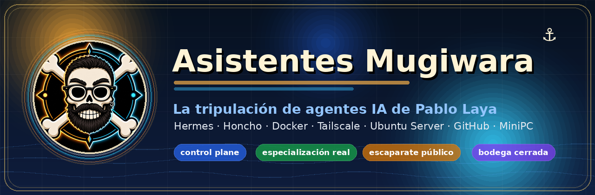

<p align="center">
  
</p>

# 🏴‍☠️ Asistentes Mugiwara

Mugiwara aborda un problema práctico: **cómo delegar tareas a varios agentes de IA en Linux sin darles acceso indiscriminado a datos y herramientas**.

**[Pablo Laya](https://github.com/Prodelaya)** diseñó, integró y opera el sistema: definió cómo se delegan las tareas, qué puede hacer cada agente y qué se revisa antes de publicar. La implementación se hizo con asistencia intensiva de IA. El [caso Mugiwara](https://prodelaya.dev/#case-mugi) recoge el contexto del proyecto.

## Tres repositorios, tres puntos de entrada

- 🏴‍☠️ **Asistentes Mugiwara** (este repositorio): [mapa de responsabilidades](#tripulación-y-responsabilidades) y [recorrido textual del panel](#recorrido-del-panel).
- 🗺️ **Mugiwara no Hermes**: [arquitectura y capas de memoria](https://github.com/asistentes-mugiwara/mugiwara-no-hermes/blob/4789fc50a1eeb5e2a8ac407ce508387958cb58e4/docs/architecture.md) y [flujo de delegación, revisión y publicación](https://github.com/asistentes-mugiwara/mugiwara-no-hermes/blob/4789fc50a1eeb5e2a8ac407ce508387958cb58e4/docs/workflow-model.md).
- 🕹️ **[Mugiwara Control Panel](https://github.com/asistentes-mugiwara/mugiwara-control-panel)**: repositorio de la consola de observabilidad y navegación.

`mugiwara-no-hermes` se distribuye con licencia MIT. El perfil y el panel son públicos, pero no declaran licencia.

## Qué se puede comprobar

- **Separación entre sistema y escaparate.** El [modelo público de Mugiwara no Hermes](https://github.com/asistentes-mugiwara/mugiwara-no-hermes/blob/4789fc50a1eeb5e2a8ac407ce508387958cb58e4/docs/system-vs-showcase.md) distingue qué explica el portfolio —roles, arquitectura y criterios— de lo que pertenece a la operación privada.
- **Publicación con revisión previa.** La [política y su lista de comprobación](https://github.com/asistentes-mugiwara/mugiwara-no-hermes/blob/4789fc50a1eeb5e2a8ac407ce508387958cb58e4/docs/publishing-policy.md) documentan qué se puede publicar, qué requiere saneado y qué se queda fuera por defecto. Es un criterio documentado, no una auditoría de cada publicación.

## Arquitectura resumida

```text
persona → coordinación y agentes especializados → herramientas gobernadas
                          ↓
        memoria relacional · memoria técnica · canon curado
                          ↓
            servicios privados · control panel privado
                          ↓
               material seleccionado para publicación
```

La separación entre rol, perfil, proceso y servicio evita presentar una identidad narrativa como prueba de ejecución. El mapa ampliado vive en [Mugiwara no Hermes](https://github.com/asistentes-mugiwara/mugiwara-no-hermes).

## Recorrido del panel

1. **Inicio:** ofrece un resumen para orientarse antes de consultar una vista específica.
2. **Tripulación:** permite consultar los perfiles y entender qué responsabilidad tiene cada agente.
3. **Conocimiento:** distingue el catálogo de habilidades, la memoria y el conocimiento curado para navegar cada capa por separado.

El recorrido describe el diseño de la consola. No es una demo en vivo ni acredita su disponibilidad actual.

## Tripulación y responsabilidades

| Función técnica | Identidad narrativa | Responsabilidad |
|---|---|---|
| Coordinación y cierre ejecutivo | 🧭 **Luffy** — etiqueta narrativa CEO | Prioriza, delega y cierra decisiones. |
| Arquitectura y entrega de software | ⚔️ **Zoro** — etiqueta narrativa CTO | Implementación, revisión, QA y gobierno técnico. |
| Infraestructura y sistemas | 🛠️ **Franky** | Servicios, automatización, despliegues y backups. |
| Finanzas y administración operativa | 💰 **Nami** — etiqueta narrativa CFO | Control económico, reporting y gestión administrativa. |
| Marketing, diseño y comunicación | 🎯 **Usopp** | Marca, narrativa, UI/UX y mantenimiento editorial. |
| Investigación e inteligencia | 📚 **Robin** | Investigación, síntesis, documentación y contraste. |
| Ciberseguridad | 🩺 **Chopper** | Secretos, permisos, hardening y superficie de ataque. |
| Asistencia personal y seguimiento cotidiano | 🍽️ **Sanji** | Apoya en agenda, compras, servicios, reservas y viajes. Sigue los pendientes hasta verificar el cierre y pide autorización para acciones externas sensibles. |
| Legal y burocracia | 🐋 **Jinbe** | Derecho español, contratos y trámites. |
| Datos y analítica | 🎷 **Brook** | Métricas, pipelines, proyección y análisis cuantitativo. |

CEO, CTO y CFO son **etiquetas narrativas de responsabilidad**, no cargos societarios, títulos profesionales ni acreditaciones.

## Estado documentado y límites

Los repositorios documentan arquitectura y decisiones. Un perfil o una descripción de un componente no demuestra que esté activo en este momento.

La política de publicación establece que la configuración privada, la memoria y los datos operativos quedan fuera por defecto. Esa política no certifica el contenido de cada revisión publicada.

## Herramientas de terceros y créditos

El sistema se apoya, entre otras piezas, en [Hermes Agent](https://github.com/NousResearch/hermes-agent), [Honcho](https://github.com/plastic-labs/honcho), [Engram](https://github.com/Gentleman-Programming/engram), [OpenCode](https://github.com/anomalyco/opencode), [gentle-ai](https://github.com/Gentleman-Programming/gentle-ai), [CodeGraph](https://github.com/colbymchenry/codegraph), [Git](https://github.com/git/git) y [GitHub](https://github.com).

La infraestructura documentada utiliza **Ubuntu Server** como entorno Linux, **Docker** para contenedores y servicios, **Tailscale** como red privada y un vault canónico propio como capa de conocimiento curado.

Esos proyectos y herramientas de terceros reciben crédito por sus aportaciones; no se les atribuye la autoría de Mugiwara.

## Seguridad, contribuciones y contacto

Si detectas una posible exposición, evita reproducirla en una issue pública y contacta de forma privada indicando solo la ruta y el tipo de riesgo.

- GitHub de Pablo: [github.com/Prodelaya](https://github.com/Prodelaya)
- Portfolio: [prodelaya.dev](https://prodelaya.dev/)
- Caso: [prodelaya.dev/#case-mugi](https://prodelaya.dev/#case-mugi)
- Contacto: [proyectos.delaya@gmail.com](mailto:proyectos.delaya@gmail.com)

Las contribuciones documentales deben preservar claridad, atribución y saneado deny-by-default.

## Nota de identidad no oficial

Mugiwara usa una narrativa de tripulación pirata para identificar responsabilidades. Es una identidad lúdica y no es un proyecto oficial ni está afiliado a One Piece, Shueisha, Toei Animation o Eiichiro Oda.
